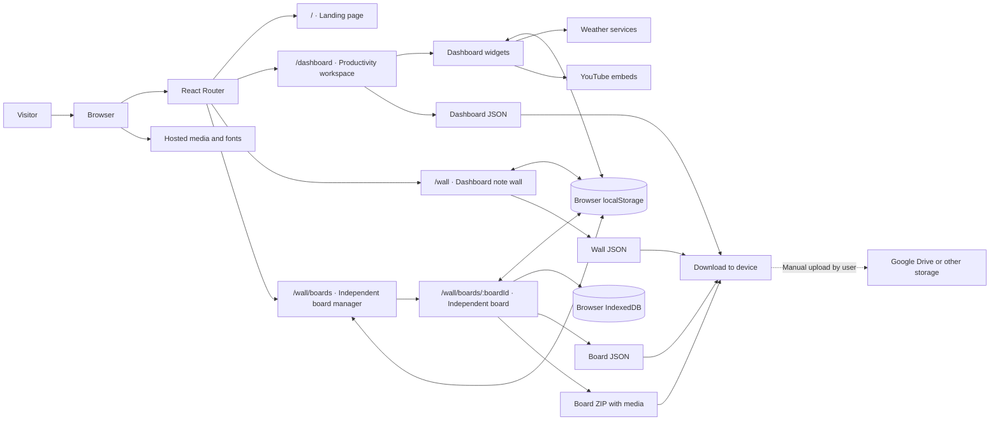
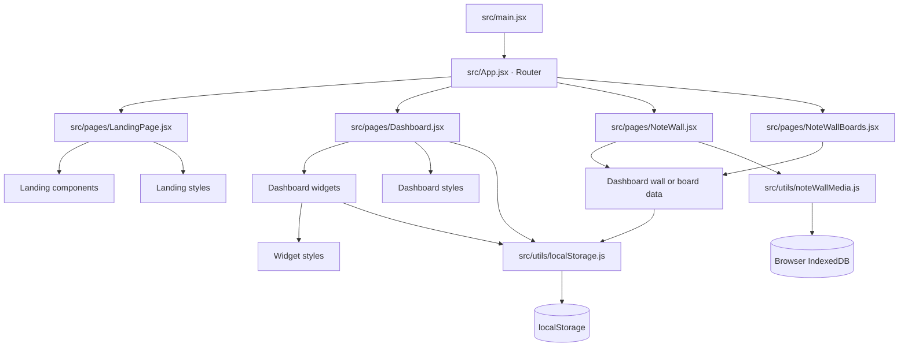
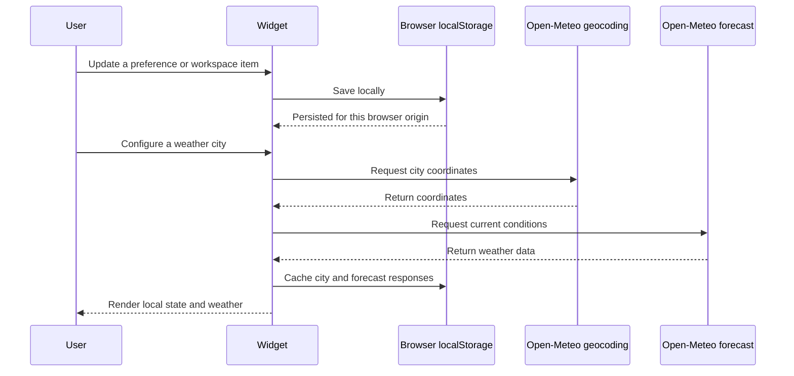
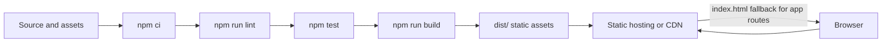

# Architecture

This document describes the current implementation so contributors can make changes in the right place. It reflects the code in this repository, not every idea in the product brief.

## Overview

Kazedesk is a client-rendered single-page application built with React and Vite. There is no application backend, server-side database, authentication layer, or server-side rendering. The browser loads the built assets, renders the routes, and stores workspace state locally.



The diagram shows the main runtime boundaries. Local data remains in the browser unless the user explicitly downloads a backup. Any upload to Google Drive or other storage is performed manually by the user, outside Kazedesk. Weather lookups and embedded or hosted media are requests to third-party services.

## Source layout

| Path | Responsibility |
| --- | --- |
| `src/main.jsx` | React entry point and global stylesheet initialization. |
| `src/App.jsx` | Route declarations for the landing page, dashboard, dashboard wall, and independent boards. |
| `src/pages/` | Route-level page composition. |
| `src/pages/NoteWallBoards.jsx` | Creates and manages independent named note-wall boards. |
| `src/components/` | Dashboard widgets and landing-page sections. |
| `src/components/landing/` | Components specific to the public landing page. |
| `src/styles/` | Component and page stylesheets. |
| `src/utils/localStorage.js` | Storage keys, persistence helpers, defaults, and legacy preference migration. |
| `src/utils/noteWallMedia.js` | IndexedDB persistence for note-wall attachment files. |
| `src/utils/backupArchive.js` | ZIP creation/parsing and attachment-manifest restoration helpers. |
| `src/utils/noteWallBackup.js` | Wall JSON validation and custom-board ZIP archives. |
| `src/utils/dashboardBackup.js` | Full dashboard JSON export and validation. |
| `src/assets/` | Images and other bundled assets. |
| `public/` | Static files copied directly into the build output. |

## Application composition

`src/App.jsx` uses React Router to map `/` to the landing page, `/dashboard` to the workspace, `/wall` to the dashboard-connected sticky-note wall, `/wall/boards` to the independent board manager, and `/wall/boards/:boardId` to an individual board. `src/pages/Dashboard.jsx` composes the widgets and owns dashboard-level layout, drag/resize interactions, and appearance state. Individual widgets own their feature-specific interaction and presentation.

The dashboard layout and user-created content are persisted in browser storage. `src/utils/localStorage.js` centralizes several storage operations and default values; some older widget settings still use their legacy storage keys directly. When changing persisted data, preserve existing keys or provide an explicit migration so existing users do not lose their work.

The original `/wall` continues to read the dashboard's sticky notes and tasks. Independent boards are listed at `/wall/boards` and store their own notes, tasks, folders, layout, connections, comments, links, and attachment references under a separate local-storage key. Board-owned content does not write to dashboard note or task keys. Board notes preserve Markdown source and render a safe preview (headings, inline formatting, lists, links, images, tables, footnotes, and other common syntax) without interpreting embedded HTML. Markdown links in board-note source are automatically stored as note-relative paperclip cards when the note is created, edited, or loaded; existing offsets remain stable. Web clips can be attached to a note through their pin menu and store both the note ID and a relative offset, while their wall position remains synchronized for connections and exports. Attached links stack near the note's lower-right edge, can be dragged independently, and move with their note. Link cards render as compact rectangles, expand on hover, and expose edit/delete actions from an outside-click-dismissible menu. Folders can be created while editing a note. Attachment blobs remain in browser IndexedDB and are referenced by board-specific IDs. Wall/dashboard JSON and board JSON exports contain references only; custom-board ZIP archives include attachment files.



The page components compose the UI; widgets encapsulate feature behavior. Shared persistence helpers centralize common storage operations, while some legacy settings remain owned by their widgets.

## Pip and board navigation

The landing page's `LandingPip` follows the pointer, settles in open areas, and changes to a random animation when clicked. The shared `PipIcon` brand mark uses the settled Pip GIF in the landing navigation, footer, and information-page headers. The dashboard's `DigitalPet` listens for focus-session and task-completion events to show the matching reminder animation.

The Note Wall toolbar's board-name switcher links to the workspace, dashboard wall, board manager, and up to three recently opened boards. Opening a custom board records its last-opened timestamp in the existing board storage. Choosing a destination opens a confirmation before navigation. Board groups and their spread settings remain part of the locally persisted board data; the docked branched sidebar indexes folders and their contents.

## Data and persistence

- Data is scoped to the website origin and browser profile.
- There is no automatic remote synchronization or server-side backup. Dashboard Settings and the main wall use JSON exports without attachment file contents. Custom boards support JSON references and ZIP archives that include their attachment files. Exports are generated locally; uploads to third-party storage are manual.
- Workspace preferences, board definitions, and note-wall data are stored in `localStorage`; attachment file contents are stored in `IndexedDB`.
- Wall and dashboard JSON exports store attachment references, which resolve only while the matching IndexedDB files remain in the same browser profile. Custom-board ZIPs carry media files for portable restoration.
- The analytics widget derives its views from locally stored events.
- Workspace export/import is intended for user-managed backups.
- Local storage can be cleared by the browser or user and has finite capacity. Large custom backgrounds may exceed browser quotas.

Do not put secrets or sensitive credentials in client-side code or browser storage. Anything shipped to the browser is visible to users.



The weather interaction is shown separately because it sends the user-entered city to an external service. City lookup results are cached in local storage for 30 days and forecasts for four hours, reducing repeat requests from the same browser. A local request budget limits each browser profile to three geocoding requests and six forecast requests per UTC day, with a short cooldown for repeated requests of the same type. These client-side limits can be bypassed and do not provide a shared quota or global rate limit.

## External integrations

- **Weather:** the configured city is sent to Open-Meteo's geocoding API; the returned coordinates are used for a current-conditions request to Open-Meteo's forecast API. Results are cached per browser.
- **Web clips:** direct URL pins try to fetch public HTML metadata without credentials. Cross-origin restrictions mean many sites block this; the browser bookmarklet reads metadata on the source page as a fallback. Preview images are loaded from the image URL supplied by the page. Compact link cards size to the title/site label; hovering reveals available metadata without scrolling. Attached web clips and Markdown links retain independent drag offsets relative to their note.
- **YouTube:** playlist playback uses YouTube content and browser embedding behavior.
- **Manual backups:** Kazedesk creates JSON locally for dashboard and wall exports, and ZIPs for custom-board backups. Custom-board ZIPs include media; JSON files store references only. Kazedesk makes no Google Drive API calls. Any upload to Drive or another provider is initiated by the user and governed by that provider's policies.
- **Ambient visualizer:** optional system-audio capture uses `getDisplayMedia` and the Web Audio API. Browser permission, secure-context, and supported-audio-track requirements apply. Simulated mode does not access audio.
- **Landing-page media and fonts:** some content is loaded from external providers. A network connection is needed for those resources.

External services can change availability, terms, or rate limits independently of Kazedesk. Handle failed requests gracefully and avoid adding credentials to frontend bundles.

Open-Meteo weather data is attributed in the widget and is provided under CC BY 4.0. Its free API is for non-commercial use and is subject to request limits; see the [Open-Meteo terms](https://open-meteo.com/en/terms). Because weather requests are made directly by each browser, the static application cannot enforce a global request limit or share cached results across visitors. If usage grows beyond the provider's permitted free usage, route requests through a shared edge cache or backend with appropriate caching and rate limits.

## Build and deployment

Vite compiles the app and static assets into `dist/`. The same static output can be served from a CDN or static host; the host must provide an SPA fallback to `index.html` for direct navigation to `/dashboard`.

Deploying under a URL prefix requires configuring Vite's `base` and React Router's basename consistently. No Docker image or persistent server is required for the current architecture.



## Quality checks

Run the following checks before submitting changes:

```bash
npm run lint
npm test
npm run build
```

The repository's GitHub Actions workflow runs all three checks for pushes and pull requests.
