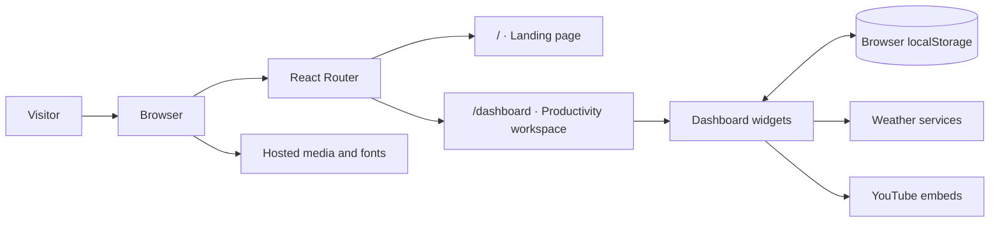
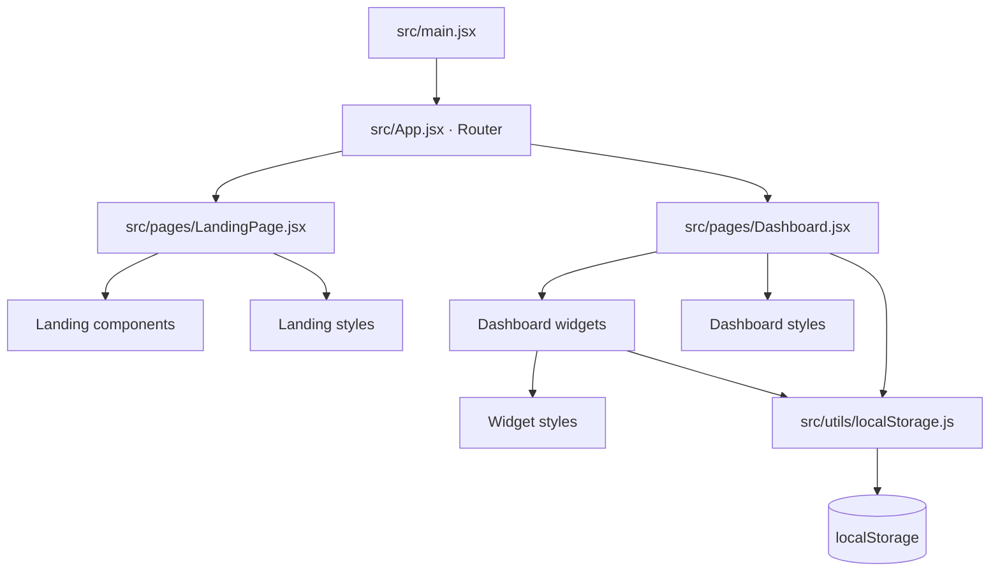
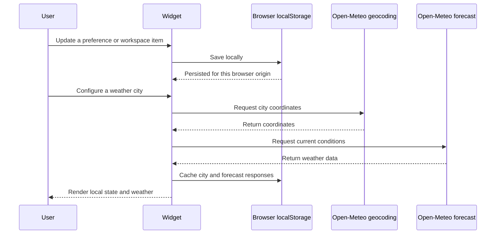
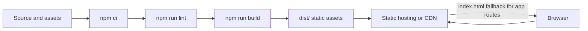

# Architecture

This document describes the current implementation so contributors can make changes in the right place. It reflects the code in this repository, not every idea in the product brief.

## Overview

Kazedesk is a client-rendered single-page application built with React and Vite. There is no application backend, database, authentication layer, or server-side rendering. The browser loads the built assets, renders the routes, and stores workspace state locally.

The diagram shows the main runtime boundaries. Local data remains in the browser; weather lookups and embedded or hosted media are requests to third-party services.

## Source layout

| Path | Responsibility |
| --- | --- |
| `src/main.jsx` | React entry point and global stylesheet initialization. |
| `src/App.jsx` | Route declarations for the landing page and dashboard. |
| `src/pages/` | Route-level page composition. |
| `src/components/` | Dashboard widgets and landing-page sections. |
| `src/components/landing/` | Components specific to the public landing page. |
| `src/styles/` | Component and page stylesheets. |
| `src/utils/localStorage.js` | Storage keys, persistence helpers, defaults, and legacy preference migration. |
| `src/assets/` | Images and other bundled assets. |
| `public/` | Static files copied directly into the build output. |

## Application composition

`src/App.jsx` uses React Router to map `/` to the landing page and `/dashboard` to the workspace. `src/pages/Dashboard.jsx` composes the widgets and owns dashboard-level layout, drag/resize interactions, and appearance state. Individual widgets own their feature-specific interaction and presentation.

The dashboard layout and user-created content are persisted in browser storage. `src/utils/localStorage.js` centralizes several storage operations and default values; some older widget settings still use their legacy storage keys directly. When changing persisted data, preserve existing keys or provide an explicit migration so existing users do not lose their work.

The page components compose the UI; widgets encapsulate feature behavior. Shared persistence helpers centralize common storage operations, while some legacy settings remain owned by their widgets.

## Data and persistence

- Data is scoped to the website origin and browser profile.
- There is no remote synchronization or server-side backup.
- The analytics widget derives its views from locally stored events.
- Workspace export/import is intended for user-managed backups.
- Local storage can be cleared by the browser or user and has finite capacity. Large custom backgrounds may exceed browser quotas.

Do not put secrets or sensitive credentials in client-side code or browser storage. Anything shipped to the browser is visible to users.

The weather interaction is shown separately because it sends the user-entered city to an external service. City lookup results are cached in local storage for 30 days and forecasts for four hours, reducing repeat requests from the same browser. A local request budget limits each browser profile to three geocoding requests and six forecast requests per UTC day, with a short cooldown for repeated requests of the same type. These client-side limits can be bypassed and do not provide a shared quota or global rate limit.

## External integrations

- **Weather:** the configured city is sent to Open-Meteo's geocoding API; the returned coordinates are used for a current-conditions request to Open-Meteo's forecast API. Results are cached per browser.
- **YouTube:** playlist playback uses YouTube content and browser embedding behavior.
- **Ambient visualizer:** optional system-audio capture uses `getDisplayMedia` and the Web Audio API. Browser permission, secure-context, and supported-audio-track requirements apply. Simulated mode does not access audio.
- **Landing-page media and fonts:** some content is loaded from external providers. A network connection is needed for those resources.

External services can change availability, terms, or rate limits independently of Kazedesk. Handle failed requests gracefully and avoid adding credentials to frontend bundles.

Open-Meteo weather data is attributed in the widget and is provided under CC BY 4.0. Its free API is for non-commercial use and is subject to request limits; see the [Open-Meteo terms](https://open-meteo.com/en/terms). Because weather requests are made directly by each browser, the static application cannot enforce a global request limit or share cached results across visitors. If usage grows beyond the provider's permitted free usage, route requests through a shared edge cache or backend with appropriate caching and rate limits.

## Build and deployment

Vite compiles the app and static assets into `dist/`. The same static output can be served from a CDN or static host; the host must provide an SPA fallback to `index.html` for direct navigation to `/dashboard`.

Deploying under a URL prefix requires configuring Vite's `base` and React Router's basename consistently. No Docker image or persistent server is required for the current architecture.

## Quality checks

Run `npm run lint` and `npm run build` before submitting changes. The repository's GitHub Actions workflow runs both checks for pushes and pull requests.
