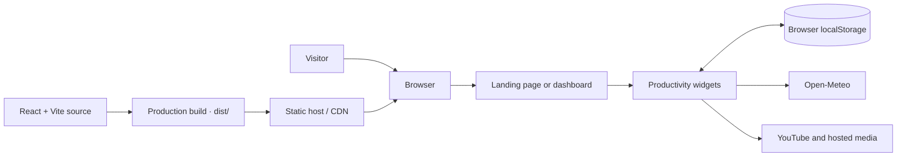

# Kazedesk

**Make room for deep focus.** Kazedesk is a calm, customizable productivity workspace for focus sessions, tasks, notes, and music. It runs in the browser and stores personal workspace data locally on the device.

<p align="center">
  
</p>

> **Project status:** actively evolving. Features, screenshots, and behavior may change as the project develops.

## Features

- A customizable dashboard with movable and resizable widgets.
- A focus timer with configurable work and break durations.
- Tasks with reminders, nested subtasks, daily repeat controls, and user-created folders.
- Rich-text sticky notes with user-created folders and per-note tags.
- A resizable sticky-note wall with folder/tag filtering, compact task cards with hover details, a toggle to hide Inbox/unfiled tasks, and undo/redo for wall edits. Same-folder note links are solid, shared-tag note links are dotted, and task-to-note links in custom folders are dashed. Automatically managed crossing links use distinct colors adapted to dark/light mode; manually chosen line colors are preserved. Tidy-and-center creates missing eligible relationships, spaces and centers the visible board, and confirms whether to keep or clear existing lines. Wall changes autosave locally with visible save feedback; links can be curved or straight with selectable card/line colors. Includes full-note viewing, board panning and zooming, PNG/PDF/Markdown/JSON export, and optional private Google Drive saves.
- Focus-session analytics stored locally.
- A weather and clock widget, with city lookup and forecasts from Open-Meteo.
- YouTube playlist playback (public playlists only).
- Dashboard appearance settings, saved layouts, and workspace import/export.
- An optional ambient visualizer with simulated animation or browser-supported system-audio capture.

## Screenshots

| Screenshot | Description |
| --- | --- |
|  | **A complete focus workspace.** Arrange your timer, weather, task list, analytics, and notes around a customizable background. |
|  | **Keep the essentials in view.** Minimize other widgets to create a quieter workspace with just the timer and local time and weather. |
|  | **Personalize your setup.** Manage YouTube playlists and adjust workspace preferences from dashboard settings. |

## How it works

Kazedesk is a static, client-side React app. Your workspace data stays in the current browser; only features such as weather lookup and embedded media contact external services.



## Getting started

### Requirements

- Node.js 22.12 or later (or Node.js 20.19 or later).
- npm, included with Node.js.

### Install and run

```bash
git clone https://github.com/Ryson-Theo/Kazedesk.git
cd kazedesk
npm ci
npm run dev
```

Open the local URL printed by Vite (usually `http://localhost:5173`). The landing page is at `/`, the workspace is at `/dashboard`, and the sticky-note wall is at `/wall`.

### Optional Google Drive saves

The wall can save a JSON copy to the signed-in user's Google Drive. To enable it, create a Google OAuth web client, enable the Google Drive API for its Google Cloud project, add your development/deployed origins as authorized JavaScript origins, and copy `.env.example` to `.env.local` with the client ID. The browser app requests the `drive.file` scope and creates a private file; it does not make the file public or store OAuth access tokens in local storage. Drive saves require the user to authorize the app and are subject to Google's quotas and policies. Without this setup, local autosave and downloadable exports continue to work.

### Available scripts

| Command | Description |
| --- | --- |
| `npm run dev` | Start the Vite development server. |
| `npm run build` | Create a production build in `dist/`. |
| `npm run preview` | Preview the production build locally. |
| `npm run lint` | Run Oxlint on the project. |
| `npm test` | Run the automated component and behavior tests. |

## Deploying

Kazedesk is a client-side React application and can be deployed to a static hosting provider. Connect the repository to a provider such as Cloudflare Pages, Netlify, or Vercel and configure:

- **Build command:** `npm run build`
- **Output directory:** `dist`

Configure the host to serve `index.html` for application routes such as `/dashboard` (SPA fallback). A root-domain deployment works with the default Vite configuration. If deploying beneath a repository subpath, configure Vite's `base` option and the router's basename for that path.

Docker is not required for the current static application. See [ARCHITECTURE.md](./ARCHITECTURE.md) for its runtime boundaries and deployment considerations.

## Privacy and browser capabilities

Kazedesk has no application server or account system. Settings, tasks, notes, tags, wall positions/sizes/connections, layouts, playlists, and analytics are stored in the browser's `localStorage` for the current origin. This data does not automatically sync between browsers or devices. Clearing site data removes it; use the workspace backup feature or export the wall before changing browsers or devices. Google Drive saves are optional private copies; downloadable PNG, print-to-PDF, Markdown, and JSON exports are also available.

The weather widget sends the configured city to Open-Meteo for geocoding and weather data, with an attribution link beside displayed weather. City lookups are cached in the browser for 30 days and forecasts for four hours. To limit accidental repeat requests, each browser profile allows up to three city lookups and six forecast requests per UTC day, with a short cooldown between same-type requests. These client-side limits can be cleared or bypassed and are not a shared quota or security boundary. Open-Meteo's free API is for non-commercial use and has daily and short-term request limits; check its [terms](https://open-meteo.com/en/terms) before launch. A shared edge cache or backend and an appropriate API plan are needed to enforce limits across visitors or support commercial use. YouTube embeds and externally hosted landing-page media may also connect to their respective providers when used. Review those providers' privacy policies if this matters to your use.

System-audio visualization depends on browser support for screen capture and audio sharing, and generally requires HTTPS or localhost. It is optional; simulated visualization does not capture audio.

## Contributing

Contributions are welcome. Visit the [GitHub repository](https://github.com/Ryson-Theo/Kazedesk) to contribute, and start with [CONTRIBUTING.md](./CONTRIBUTING.md) for local setup, quality checks, and pull request guidance. Please read the [Code of Conduct](./CODE_OF_CONDUCT.md) before participating.

To report a vulnerability, follow [SECURITY.md](./SECURITY.md) rather than opening a public issue.

## License

Kazedesk is distributed under the [MIT License](./LICENSE).

## Maintainer

<table align="center">
  <tr>
    <td align="center">
      <a href="https://github.com/Ryson-Theo">
        
        <br />
        <strong>Ribin K Roy</strong>
      </a>
      <br />
      Project creator
      <br />
      <a href="https://ribin-portfolio.vercel.app/">Portfolio</a>
      ·
      <a href="https://github.com/Ryson-Theo">GitHub</a>
    </td>
  </tr>
</table>
