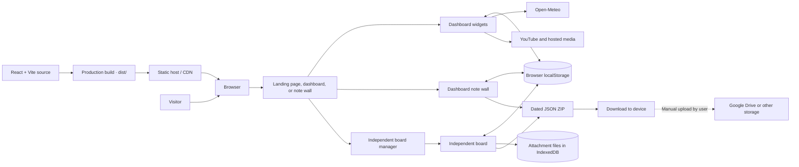

# Kazedesk

**Make room for deep focus.** Kazedesk is a calm, customizable productivity workspace for focus sessions, tasks, notes, and music. It runs in the browser and stores personal workspace data locally on the device.

<p align="center">
  
</p>

> **Project status:** actively evolving. Features, screenshots, and behavior may change as the project develops.

## Features

### A calmer workspace

- Arrange and resize dashboard widgets around your focus.
- Stay on track with a configurable focus timer, tasks, reminders, and nested subtasks.
- Keep quick notes close with folders, tags, and saved dashboard layouts.

### Space for your ideas

- Create independent note-wall boards, each with its own notes, tasks, files, links, and layout.
- Write notes in Markdown; pin links, clip web pages, and connect related ideas.
- Record voice notes with a live waveform, review playback, and discard or add recordings to the board. Audio nodes include seek and playback-speed controls.
- Pan, zoom, filter, and tidy your wall. Changes save locally, with undo and redo.
- Export wall data as JSON. Custom boards also support media-inclusive ZIP backups.

### The details that make it yours

- Review focus-session analytics and local time and weather.
- Play public YouTube playlists.
- Choose your look, and add ambient visuals with optional system-audio mode.
- Import or export your workspace.

## Screenshots

| Screenshot | Description |
| --- | --- |
|  | **A complete focus workspace.** Arrange your timer, weather, task list, analytics, and notes around a customizable background. |
|  | **Keep the essentials in view.** Minimize other widgets to create a quieter workspace with just the timer and local time and weather. |
|  | **Personalize your setup.** Manage YouTube playlists and adjust workspace preferences from dashboard settings. |

## How it works

Kazedesk is a static, client-side React app. Workspace data stays in the current browser by default. Weather lookup and embedded media contact external services. JSON and custom-board ZIP backups are generated locally; any upload to Google Drive is performed manually by the user.



## Getting started

### Requirements

- Node.js 22.12 or later (or Node.js 20.19 or later).
- npm, included with Node.js.

### Install and run

```bash
git clone https://github.com/Ryson-Theo/Kazedesk.git
cd kazedesk
npm ci
npm run dev
```

Open the local URL printed by Vite (usually `http://localhost:5173`). The landing page is at `/`, the workspace is at `/dashboard`, and its connected sticky-note wall is at `/wall`. Manage independent named boards at `/wall/boards` and open an individual board at `/wall/boards/:boardId`. The dashboard wall and independent boards keep their notes and tasks separate.

### JSON and board ZIP backups

The main sticky-note wall at `/wall` exports and imports JSON only. Its JSON stores attachment references, not media files; importing it looks up those references in this browser's IndexedDB. Those files must still exist in the same browser profile.

Custom boards support **Export JSON** and **Download backup ZIP**, with matching JSON/ZIP imports from **Note wall boards** or the board's Export menu. Board JSON also uses references to media in the current browser. ZIP backups include attached images, PDFs, and audio recordings and can restore them after browser data is cleared.

Dashboard **Settings** uses JSON only: **Export Dashboard JSON** includes dashboard preferences, weather/background settings, notes, tasks, boards, layouts, and other stored text data; **Import Dashboard JSON** restores that snapshot after confirmation. It does not include attachment file contents.

JSON and ZIP files are created locally. You can upload custom-board ZIPs to Google Drive or another provider yourself; Kazedesk does not sign in to Drive, call its API, or upload your data. Markdown, PDF, and PNG exports are also available.

### Available scripts

| Command | Description |
| --- | --- |
| `npm run dev` | Start the Vite development server. |
| `npm run build` | Create a production build in `dist/`. |
| `npm run preview` | Preview the production build locally. |
| `npm run lint` | Run Oxlint on the project. |
| `npm test` | Run the automated component and behavior tests. |

## Deploying

Kazedesk is a client-side React application and can be deployed to a static hosting provider. Connect the repository to a provider such as Cloudflare Pages, Netlify, or Vercel and configure:

- **Build command:** `npm run build`
- **Output directory:** `dist`

Configure the host to serve `index.html` for application routes such as `/dashboard` and `/privacy`, and for unknown paths handled by the branded 404 page (SPA fallback). A root-domain deployment works with the default Vite configuration. If deploying beneath a repository subpath, configure Vite's `base` option and the router's basename for that path.

Docker is not required for the current static application. See [ARCHITECTURE.md](./ARCHITECTURE.md) for its runtime boundaries and deployment considerations.

## Privacy and browser capabilities

Kazedesk has no application server or account system. Settings, tasks, notes, board definitions, tags, wall positions/sizes/connections, layouts, playlists, and analytics are stored in the browser's `localStorage` for the current origin. Note-wall attachment file contents, including voice recordings, are stored separately in browser `IndexedDB` after you add them to a board. Recording requires browser microphone permission and is available on secure origins such as HTTPS or localhost. Recordings can be previewed or discarded before saving to the board. JSON exports contain attachment references only and require the referenced IndexedDB records to remain in the same browser profile. Custom-board ZIP backups include attachment contents and can be restored after browser data is cleared. Dashboard Settings JSON does not export media files. Kazedesk does not connect to Google Drive. Any upload to Drive or another provider is initiated by the user and handled under that provider's policies.

The weather widget sends the configured city to Open-Meteo for geocoding and weather data, with an attribution link beside displayed weather. City lookups are cached in the browser for 30 days and forecasts for four hours. To limit accidental repeat requests, each browser profile allows up to three city lookups and six forecast requests per UTC day, with a short cooldown between same-type requests. These client-side limits can be cleared or bypassed and are not a shared quota or security boundary. Open-Meteo's free API is for non-commercial use and has daily and short-term request limits; check its [terms](https://open-meteo.com/en/terms) before launch. A shared edge cache or backend and an appropriate API plan are needed to enforce limits across visitors or support commercial use. YouTube embeds and externally hosted landing-page media may also connect to their respective providers when used. Review those providers' privacy policies if this matters to your use.

System-audio visualization depends on browser support for screen capture and audio sharing, and generally requires HTTPS or localhost. It is optional; simulated visualization does not capture audio.

## Contributing

Contributions are welcome. Visit the [GitHub repository](https://github.com/Ryson-Theo/Kazedesk) to contribute, and start with [CONTRIBUTING.md](./CONTRIBUTING.md) for local setup, quality checks, and pull request guidance. Please read the [Code of Conduct](./CODE_OF_CONDUCT.md) before participating.

To report a vulnerability, follow [SECURITY.md](./SECURITY.md) rather than opening a public issue.

## License

Kazedesk is distributed under the [MIT License](./LICENSE).

## Maintainer

<table align="center">
  <tr>
    <td align="center">
      <a href="https://github.com/Ryson-Theo">
        
        <br />
        <strong>Ribin K Roy</strong>
      </a>
      <br />
      Project creator
      <br />
      <a href="https://ribin-portfolio.vercel.app/">Portfolio</a>
      ·
      <a href="https://github.com/Ryson-Theo">GitHub</a>
    </td>
  </tr>
</table>
